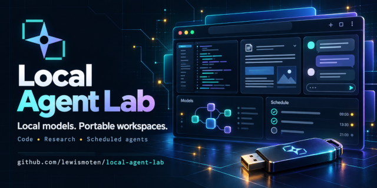

# Local Agent Lab



A browser-based AI workspace for coding, research, and scheduled agents. Run small models locally, connect optional Ollama or API profiles, and keep projects on a folder or removable drive. The site is built with React, TypeScript, and Vite; model weights and optional engines are downloaded only when you choose them.

The portable workspace is designed for people who share computers or use public library computers. Carry a USB drive to keep your projects, chats, and downloaded models available across compatible browsers without buying a computer or subscribing to an AI service. Visit [the GitHub Pages demo](https://lewismoten.github.io/local-agent-lab/) once while online on each new computer, connect the drive, then eject it in the app before unplugging. Browser support and local computer policies can limit folder access or model loading; [privacy and hosting](docs/privacy-and-hosting.md) explains what stays on that computer.

## Feature status

| Area | Available now | Current limit |
| --- | --- | --- |
| Chat and projects | Browser models, optional local or API profiles, file tools, history, memory, and scheduled agents | Agents run while the app tab is open; browser model capability varies by device. |
| Portable workspace | Folder and USB workspaces, browser-storage fallback, resumable optional downloads | Browser storage and permissions stay on the current computer. |
| Images and graphics | Browser image generation, vision tests, depth maps, SVG tracing, pose landmarks, and TripoSR meshes | Image editing, face animation, and production-quality mesh reconstruction remain open work. |
| Motion | Camera parallax, RIFE frame interpolation, WebM/MP4 or PNG-sequence export | These tools do not provide verified generative image-to-video motion. |
| Audio | Text to speech, voice profiles, voice conversion, and transcription | Model quality and live playback vary; physical mobile behavior remains unverified. |
| Offline install | Installable web app shell with optional model and engine files kept in the workspace | Visit online once per browser profile and download optional packages before disconnecting. |

## Run locally

```bash
npm install
npm start
```

Open the Vite URL in desktop Chrome or Edge to connect a portable folder. Browser storage also works without a folder. In **Models**, use **Start offline** to choose a folder, download an engine and model, and load it for chat. Nothing downloads automatically on page load.

Use **Eject workspace** before removing a USB drive. It stops new work, waits for active file operations, and unloads browser models.

## Install the web app

Open the hosted site once while online, then use your browser's **Install app** or **Add to Home Screen** action. The installed app opens in its own window and can reload offline after its app files are cached. Installing does not download models or engines; connect your portable workspace or download optional packages in **Models** when needed.

## Guides

- [Getting started, builds, and validation](docs/getting-started.md)
- [Workspace features and file layout](docs/workspace.md)
- [Large conversation checks](docs/history-performance.md)
- [Privacy, offline use, and GitHub Pages](docs/privacy-and-hosting.md)
- [Troubleshooting](docs/troubleshooting.md)
- [Model license handling](docs/model-licenses.md)
- [Visual model status and compatibility](docs/visual-model-status.md)
- [Image generation](docs/image-generation.md), [graphics and pose](docs/graphics-and-pose.md), and [video and motion](docs/video-motion.md)
- [Workspace themes and theme packs](docs/theme-packs.md)
- [Legacy Story Studio documentation](docs/legacy-story-studio.md)
- [Implementation checklist](notes/checklist.md)

## Acknowledgment

Development of Local Agent Lab includes coding assistance from GPT-6 Sol.
